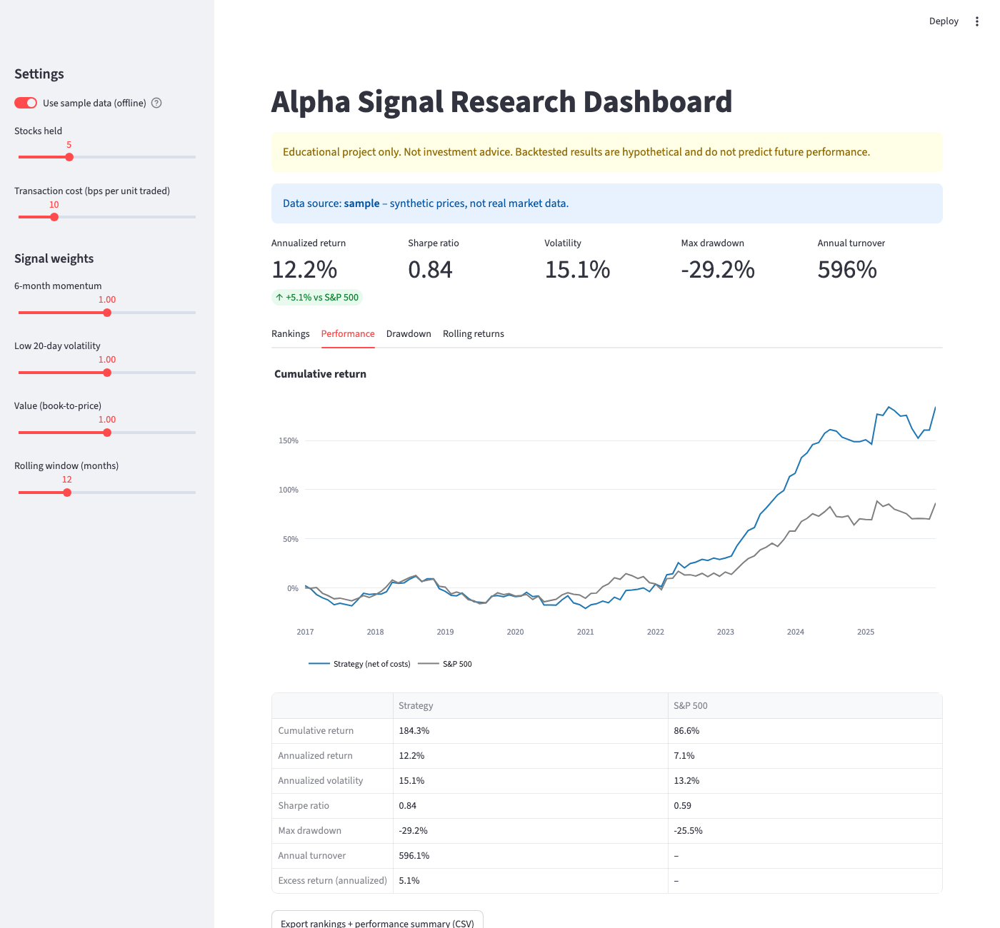
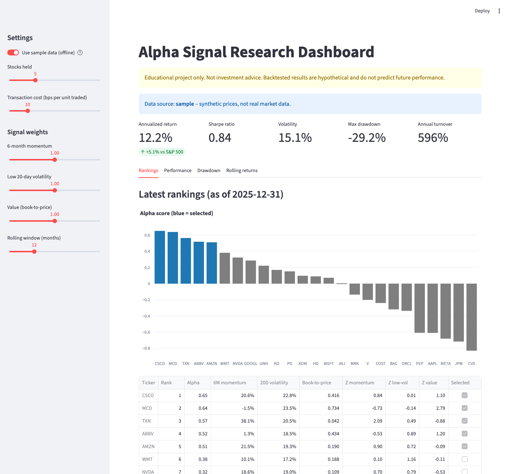

# Alpha Signal Research Dashboard

A small quantitative-investment project: three equity signals are combined into an alpha score, the top five stocks are held in an equal-weight monthly-rebalanced portfolio, and the result is backtested against the S&P 500 in a Streamlit dashboard.

> **Educational project only. Nothing here is investment advice.** Backtests are hypothetical and do not predict future performance.




*Screenshots use the built-in deterministic **synthetic** sample data (strategy-vs-benchmark gaps there are noise, not evidence of skill).*

## Setup

```bash
python3 -m venv .venv && source .venv/bin/activate
pip install -r requirements.txt
streamlit run app.py
pytest
```

The app downloads data from Yahoo Finance via `yfinance` (cached in `.cache/` for 24 hours). With no network, or by switching on **Use sample data** in the sidebar, it uses synthetic prices from a fixed random seed. No API keys or secrets are needed.

## Files

| File | Purpose |
|---|---|
| `app.py` | Streamlit dashboard, CSV export |
| `signals.py` | Momentum, volatility, value, z-scores, alpha |
| `backtest.py` | Portfolio simulation, costs, performance metrics |
| `data.py` | yfinance download, disk cache, sample-data fallback |
| `tests/test_signals.py` | Signal, look-ahead and backtest tests |

## Methodology

- **Universe:** 25 liquid US large caps (see `data.py`); benchmark is `^GSPC`. Prices are dividend/split adjusted.
- **Signals**, measured at each month-end:
  - *Momentum:* 6-month total return (higher is better).
  - *Volatility:* annualized standard deviation of the last 20 daily returns (lower is better, so its z-score is negated).
  - *Value:* book-to-price, i.e. inverse P/B (higher is better).
- **Alpha:** each signal is z-scored across stocks on each date, then combined as a weighted average (equal weights by default, adjustable in the sidebar). Missing z-scores count as neutral.
- **Portfolio:** at each month-end, hold the top 5 alpha stocks at 20% each until the next month-end.
- **Costs:** 10 bps (default) of traded notional at each rebalance; weights drift with returns between rebalances. The first rebalance from cash is charged.
- **Metrics:** cumulative and annualized return, annualized volatility, Sharpe ratio (risk-free rate 0, monthly returns), max drawdown, annual one-way turnover, and annualized excess return versus the S&P 500.
- **No look-ahead:** alpha computed at month-end *t* uses only data through *t*, and the portfolio earns the return from *t* to *t+1*. Book values in sample data are reported with a 60-day lag. `test_no_lookahead` checks that changing future prices leaves earlier alphas unchanged.

## Limitations

- **Live value signal has look-ahead bias.** `yfinance` only provides the latest book value per share, which is held constant across history, so the live value signal uses information not available at the time. Live-mode results are therefore flattered and should not be taken at face value. Point-in-time fundamentals (e.g. from a paid data vendor) are needed to fix this.
- **Survivorship bias:** the universe is today's large caps, chosen with hindsight.
- Small universe (25 stocks) and short history; results are noisy and not statistically robust. No out-of-sample testing or parameter tuning is done.
- Turnover is high (several hundred percent per year); the cost model is a flat per-trade rate with no spread, market impact or taxes.
- Trades are assumed to execute at the month-end close used to compute signals.
- The last month in live mode may be a partial month.
- Yahoo Finance data is unofficial and can be incomplete or change without notice.

## License

MIT-style use for learning; no warranty.
